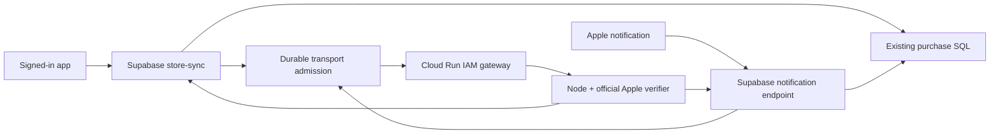

# Purchase verification runtime

Status: design and initial policy/allocation approved for local implementation, 2026-10-07; independent design review. No service, credential, policy or migration in this document has been provisioned or activated. The existing $100/month incremental budget remains in force.

## Recommendation and evidence

Use a small, IAM-private Node 24 Cloud Run service for Apple verification, separate from the paper pipeline. Keep authentication, account attribution, purchase recording and credits in the existing Supabase paths. Keep Apple's official Node SDK, trusted root, bundle/environment checks, certificate checks and online revocation policy unchanged.

The diagnostic `store-sync` deployment 36 is live. Its public-root probe reports certificate parsing and public-key export working, but `toString`, `raw`, `verify` and `infoAccess` unavailable. These are methods the pinned Apple SDK 3.1.0 uses. A new runtime log at 2026-10-08 00:55:53.431 UTC, during the explicit `x-deno-version: 2` probe, reports the same results. That log is correlated by function/time, not independently joined to the request ID. The numeric-version allowlist returned `unknown`; no arbitrary runtime string or receipt was logged. This establishes a hosted compatibility blocker, without claiming that every historical `invalid` outcome had the same cause.

Evidence: hotfix worktree `.artifacts/purchase-hotfix/postdeployment-diagnostics.json`; spending worktree `.artifacts/purchase-runtime-review/explicit-v2-runtime-log.json`. The deployed v35 shared modules matched the hotfix base byte for byte; v36 has separately been read back. Standalone Node 24 and Deno 2.9.6 each passed 13 verification/diagnostic tests, but standalone Deno is not the hosted Supabase runtime. [Supabase development runtime](https://supabase.com/docs/guides/functions/development-environment).

| Option | Supported basis | Assessment |
|---|---|---|
| Supabase managed runtime update | Supabase documented `x-deno-version: 2` / `forceDenoVersion=2`, then made the 2.1-compatible release the default. | Best if Supabase supplies a supported runtime with all required primitives and a real verification test passes. The documented switch is not a minor-version selector; no such working hosted runtime is established now. |
| Separate Node 24 verifier on Cloud Run | Apple SDK 3.1.0 documents Node 16+; Cloud Run supports Node services. | Recommended: shares the current verification implementation, avoids PDF capacity and maintenance coupling, and limits the new service's authority. |
| Python verifier in an existing worker | Apple maintains an official Python SDK using cryptography/OpenSSL and online checks. | Technically viable as a separate service, but there is no current Python Cloud Run worker to reuse in the inspected deployment. It would add a runtime, normalization/error parity work and native dependency maintenance without a demonstrated benefit. |

The managed API's published function GET, PATCH and deployment schemas contain no `deno_version` setting. Do not PATCH an undocumented field or assume `config.toml` changes the hosted runtime. The 2.1.4 source leaves the missing methods unimplemented. A supported Supabase patch remains a future alternative, tested against the same contract. [Managed API schema](https://api.supabase.com/api/v1-json), [documented preview switch](https://github.com/orgs/supabase/discussions/36814), [default rollout](https://github.com/orgs/supabase/discussions/37941), [Deno certificate implementation](https://raw.githubusercontent.com/denoland/deno/v2.1.4/ext/node/polyfills/internal/crypto/x509.ts).

Apple's Node and Python libraries both support signed-data verification, but changing languages is not necessary for this repair. Keep the current Node version pin initially; separately review future SDK/security upgrades. [Apple Node SDK](https://github.com/apple/app-store-server-library-node/blob/v3.1.0/README.md), [Apple Python SDK](https://github.com/apple/app-store-server-library-python), [Google Node hosting](https://docs.cloud.google.com/run/docs/quickstarts/build-and-deploy/deploy-nodejs-service).

## Existing worker and isolation

The current paper service is **Node 24**, not Python: `services/pipeline-worker/Dockerfile` uses `node:24-slim`. Read-only inventory of project `gradstep`, region `us-west1`, found only `gradstep-pipeline`, ready revision `gradstep-pipeline-00007-j5l`. This is a scoped inventory, not a claim about unrelated projects or regions.

That service uses a public Cloud Run URL with an application secret; it owns Supabase service-role and paid-provider credentials, runs OCR/rendering/tagging/deletion work, and admits one long pipeline run at a time. The reviewed spending branch adds a default-on maintenance barrier and an awaited 840-second worker-thread deadline. It must undergo its own [spending rollout](SPENDING_CONTROLS.md) before activation.

Adding purchases there would share memory, queueing, credentials and rollout failures with paper processing. A separate scale-to-zero verifier incurs no minimum-instance commitment and lets the paper worker remain paused while payments recover. Do not grant the verifier the pipeline identity, pipeline secret, Supabase service role, storage access, or AI/OCR credentials.

## Trust boundary and authentication

The proposed service is `gradstep-store-verifier` in project `gradstep`, region `us-west1`. Its runtime service account is `gradstep-store-verifier@gradstep.iam.gserviceaccount.com`; the separate Edge caller is `gradstep-store-caller@gradstep.iam.gserviceaccount.com`. Staging accepts only Sandbox and `com.sciencereader.ios`, using policy ID `app-store-sandbox-v1`; production gets a separate configuration and caller identity after its purchase policy review.



Use Cloud Run IAM authentication with **no `allUsers` or `allAuthenticatedUsers` invocation grant**. Create a dedicated Edge caller service account with `roles/run.invoker` on this one service only, with no project-wide or database permissions. The verifier's own runtime account has no application secrets or business-data access. Google-signed ID tokens use the exact configured Cloud Run service URL as audience. Google documents this boundary and says IAM-denied requests do not incur request billing. [Service authentication](https://docs.cloud.google.com/run/docs/authenticating/service-to-service), [Cloud Run pricing](https://cloud.google.com/run/pricing).

Prefer workload identity federation when the caller has a genuine supported workload identity. No documented per-workload OIDC identity for Supabase Edge has been established here. End-user Supabase JWTs, a fabricated service user, or the legacy service-role token are not substitutes. Creating our own issuer merely to federate would add signing-key/JWKS infrastructure rather than remove the credential problem.

For this deployment, use a dedicated Google service-account signing key held in Supabase server secret `STORE_VERIFIER_GOOGLE_CREDENTIALS` to obtain short-lived Google ID tokens through Google's maintained authentication library. Root is evaluating pinned `google-auth-library` 11.1.0's `JWT.fetchIdToken` with explicit credentials and a bounded no-redirect/no-retry transport. Version 11.2.0 had been published only hours earlier and was rejected by Deno's normal 24-hour dependency-age policy; the September 16 release is used instead of bypassing that policy. Validate the credential type, project and exact caller email; fix the token endpoint, and use expiry-aware in-memory token caching. `STORE_VERIFIER_URL` supplies the operator-configured HTTPS audience/service URL. No application-default-credential discovery, metadata fallback or client-provided credential/URL is allowed. Before adoption, test that precise library path in the hosted Edge runtime and check bundle size. If it is incompatible, review a maintained WebCrypto JOSE implementation of Google's documented exchange separately; do not silently fall back to unauthenticated ingress. Google's documentation describes both federation and service-account-key methods. The latter requires explicit key rotation, restricted IAM and a revocation procedure. [External authentication methods](https://docs.cloud.google.com/run/docs/authenticating/service-to-service#use_workload_identity_federation_from_outside_google_cloud).

A public endpoint with HMAC checked inside the container is not the recommended substitute: outsiders can still start billed container work before rejection and bypass Edge admission. IAM prevents that particular exposure. A stolen authorized caller key remains an operational risk: revoke its invocation permission/credential and disable the verifier; do not claim the application counter caps compromised credentials or every vendor charge.

## Verification protocol and data handling

Use one JWS per internal request, with explicit `transaction` or `notification` kind. The server fixes accepted environments, root fingerprint, bundle ID, SDK version and policy ID in deployment configuration; callers cannot relax them. The Edge adapter must not import or execute the Node-only Apple verifier. Share portable record schemas and normalizers so the two runtimes cannot quietly diverge.

`POST /verify` accepts this closed JSON envelope:

```ts
type VerificationRequest = {
  version: 1;
  attempt_id: string; // Fresh UUID; identifies the durable consumed transport start.
  kind: 'transaction' | 'notification';
  policy_id: 'app-store-sandbox-v1';
  signed_payload: string; // Exact compact ASCII JWS, at most 64,000 bytes.
  signed_sha256: string; // Exactly 64 lowercase hexadecimal characters.
};
```

The reply repeats `version`, `attempt_id`, `kind`, `policy_id` and `signed_sha256`, then has exactly one of these forms:

```ts
type VerificationResult =
  | { status: 'verified'; transaction: StoreTransactionRecord }
  | { status: 'verified'; notification: StoreNotificationRecord }
  | { status: 'failed'; code: VerificationCode; diagnostic: VerificationDiagnostic };
```

`StoreTransactionRecord` is the existing normalized SQL input. `StoreNotificationRecord` is exactly `{environment, notification_uuid, type, subtype, signed_at, transaction}`, where `subtype` and `transaction` may be null and `signed_at` is an ISO timestamp. A verified transaction reply contains only `transaction`; a verified notification reply contains only `notification`. `VerificationCode` retains only `invalid`, `environment_unavailable` and `verification_unavailable`; `VerificationDiagnostic` retains the existing finite stage/status/transport allowlists. Do not expand the public client outcome or finish rules as part of transport repair.

Only the configured HTTPS service URL is allowed; no redirects, caller URLs, automatic transport retry, or arbitrary outbound verification target. The service recomputes the hash. HTTP 200 carries verified or deterministic rejected decisions; transient `verification_unavailable` uses HTTP 503. Invalid framing, oversize bodies, maintenance and local capacity reject before starting a worker thread. The Edge adapter strictly validates the binding, discriminated response schema, expected operation and response size before calling the existing SQL recorder. Nonconforming or unbound replies, transport failures and local busy responses become retryable `verification_unavailable`. It never accepts a client-supplied decoded transaction or a bare `verified: true`.

TLS to the exact operator-configured Cloud Run hostname supplies response authenticity; attempt/digest binding prevents cross-request mixups. The verifier has no database credential and cannot independently redeem the attempt; one-use start enforcement is the trusted Edge adapter's durable database operation before its one send. IAM plus that code boundary is part of the design, not an assertion that UUIDs prevent an authorized compromised caller from replaying work. No extra response-signing key is needed for this synchronous, non-persisted exchange. If responses later cross a queue, untrusted intermediary or durable cache, revisit signed attestations before changing the protocol.

The notification operation verifies the outer Apple notification and its inner signed transaction, checks their environments agree, and returns the normalized notification plus transaction. It does not return/store the nested JWS, call purchase SQL, or acknowledge Apple itself. SDK certificate caching may retain public chain information according to the unchanged SDK policy; do not cache a customer receipt or a permanently rejected receipt hash.

Retain the existing 64,000-character JWS bound, explicitly requiring compact ASCII/base64url framing and its three nonempty segments before forwarding; enforce the UTF-8 byte bound too. Match the SDK-required chain shape. Parse only bounded framing/JSON before expensive verification. Unverified fields can reject impossible input or select an allowed environment; they never authorize a purchase. The public notification HTTP body remains at most 256,000 bytes, with the signed string bound enforced before forwarding. Application batches stay at most 25 entries; each forwarded entry consumes admission separately. Both internal request and response bodies are bounded at 72 KiB. This allows the normalized subset of the already bounded decoded payload without silently imposing new financial-field restrictions merely to meet a smaller transport limit; verify this with maximum-size fixtures.

No JWS, certificate chain, decoded claims, account token, auth header, raw exception or response body enters application logs, tracing, support reports, object storage, URLs or crash telemetry. Processing is in memory. Log only deployment/policy, fixed stage/outcome, duration and counts; request IDs can correlate transport, but do not log receipt digests by default. Google access logs contain transport metadata; audit log configuration for unexpected body capture before launch.

## Independent admission migration 033

Staging is at 032. Slot **033 is unused**, after the upload draft was renumbered to 039. A small reviewed `033_purchase_verification_transport` migration can repair this path without applying 034–039. It must be committed, tested against populated 032, and included in the later complete migration prefix. Do not apply one-off SQL or depend on 038 account diagnostics for the repair.

Add a disabled-by-default policy, durable one-use transport attempts and aggregate transport counters, with separate `app` and `notification` channels. A service-role-only admission/start RPC validates the channel and byte bounds, then atomically checks/increments hour/day/month counters and consumes a fresh attempt before returning permission to make **one** internal request. Replaying the same attempt cannot return a new send grant. App admission requires a real open account and adds an account/hour limit; notification admission has no account or claimed identity. Existing `worker_consume_request` cannot serve this anonymous case unchanged: it requires an open account. No sentinel account is created.

Proposed beta policy, to be approved/configured explicitly:

| Channel | Account/hour | Environment/hour | Environment/day | Environment/UTC calendar month |
|---|---:|---:|---:|---:|
| App transactions, including restore/retry | 50 | 500 | 300 | 3,000 |
| Outer notification plus inner transaction | — | 60 | 200 | 1,000 |

The separate allowances keep anonymous notification traffic from consuming the app's quota. Fixed-window bursts at boundaries are possible; monthly admission remains bounded. The service concurrency/deadline limits independently contain each accepted request. Caps are infrastructure allowances, not customer credits or Apple transaction counts.

Serialize admission on the channel policy row. For app calls, lock the real account before that row; never discover/lock an account after a notification/global policy lock. Counter scopes are an explicit finite enum, not client-supplied strings. Retain aggregate environment totals through account deletion. Prune old short windows and completed attempt observations through the existing operations schedule, retaining current and prior monthly aggregates for investigation; bound account/hour and attempt rows by admitted requests and retention. No denied anonymous request creates a per-request row. Configuration changes preserve usage rather than reset it. Optional fixed completion observations never refund starts or authorize another invocation.

Do not store attacker-selected receipt hashes as permanent denial/deduplication keys. Repeating an invalid receipt must not poison a later legitimate caller. Anonymous attempts use random transport identities and contain no JWS, receipt hash or unverified Apple identity. Every actual resend needs another successful committed start; disable HTTP-client retries. If the start response is lost or ambiguous, make no verifier call. If a verifier reply is lost, a later request consumes another slot with a new attempt ID; no quota refund follows a timeout. Existing purchase SQL still makes financial recording idempotent by verified transaction identity. Retry/cancellation tests must establish that a replayed start, duplicate callback or delayed observation cannot produce a second send grant.

Malformed framing is rejected before admission. Quota exhaustion or unavailable admission returns a retryable service failure; it never returns a successful receipt acknowledgement. In particular, Apple notifications receive 503 so production retries remain possible. Sandbox notifications do not retry; app restore/unfinished delivery remains the existing backstop, and API reconciliation is still a separate pending feature. Anonymous flooding can exhaust its notification allowance and delay legitimate delivery; alert on refusals and investigate rather than silently expanding the limit or pretending the flood is cost-free.

### Notification authentication before admission (review A8, 2026-10-21)

The flooding risk above was real: the only check before `worker_start_store_verifier` consumed the global
`notification` allowance (60/hour, 200/day, 1,000/month) was compact-JWS framing, and the URL is public and
predictable, so a script posting JWS-shaped junk could use the allowance and delay real notifications (Sandbox does not
retry reliably). The Edge function now authenticates the outer JWS itself, before any database call, admission or
verifier request (`_shared/app-store-jws.ts`), with the checks Apple's library applies to the outer JWS:

- `alg` is `ES256` and `x5c` holds exactly three base64 DER certificates (bounded sizes);
- the third is byte-identical to the pinned Apple Root CA - G3 (the same bytes and published SHA-256 as the verifier's
  `app-store.ts`; a test asserts they are identical, so the root is still pinned in one reviewed value);
- the intermediate names the root as issuer, is signed by the root's key and is a CA (basic constraints); the leaf
  names the intermediate and is signed by it (ECDSA with SHA-256 or SHA-384, P-256 or P-384, DER signatures converted
  to WebCrypto's r||s);
- the leaf carries Apple's App Store receipt-signing marker `1.2.840.113635.100.6.11.1` and the intermediate the WWDR
  marker `1.2.840.113635.100.6.2.1`;
- every certificate is valid now within Apple's 60-second skew (the verifier runs with online checks, so Apple's
  library also uses the current time);
- the JWS signature verifies under the leaf's P-256 key;
- the payload names our bundle ID and an allowed environment (`data`, `summary`, `appData` or
  `externalPurchaseToken`, as Apple's library reads them), so Apple-signed notifications of another app cannot use our
  allowance either.

It uses WebCrypto and a minimal bounded DER reader only: no Apple SDK and no `node:crypto` X509 methods (unavailable in
the hosted Edge runtime, above). A refusal answers the same `400 {"outcome":"invalid"}` an unverifiable payload always
received (the hosted `store` check and `scripts/smoke-store.mjs` expect it) and logs only a fixed code
(`notification_unauthenticated`, `failure`); no JWS, certificate or claim. It decides only whether a request may
consume admission: the private verifier still runs Apple's SDK with OCSP, the inner transaction, environment
agreement and every financial rule, and nothing here authorizes a purchase. A genuine notification of our own app can
still be replayed by whoever holds one; it consumes one admission and records nothing twice (purchase SQL is
idempotent). The production function passes no root or clock: the test-only parameters cannot be set from
configuration or a request. Tests: `tests/backend/app-store-jws.test.ts` (an Apple-shaped P-384/P-256 chain; a negative
case for every check; the real root parses and verifies its own signature).

Not done: a daily reconciliation from the App Store Server API's notification history. It needs an App Store Connect
In-App Purchase API key (issuer ID, key ID, private key) for this app, which is not configured for the Edge or the
verifier, and its own design for credentials, scheduling and idempotent replay; until then app restore and the app's
own transaction sync remain the backstop for a lost Sandbox notification.

Keep 038's account observations and later owner ledger separate. Migration 033 needs a bounded owner readout of admitted/denied counts, remaining allowance and policy state, with no receipt content. Later admin integration can display the same contract without redefining it.

## Execution bounds and cost

Initial service configuration: request-based billing; 1 vCPU, 512 MiB; minimum zero; maximum one at both service and revision scope; concurrency two. Pin image digest and numerical secret references if any are introduced. Expose no paid-work scheduler or background loop. The service starts in maintenance until its exact configuration/authentication checks pass.

Run each verification in one Node worker thread. The parent enforces **40 seconds for a transaction**, **70 seconds for a notification's two verifications**, and awaits termination/join before responding, including after success. The unchanged SDK checks leaf/intermediate OCSP concurrently with 30-second transport timeouts; the outer and inner notification operations can then be sequential. A fresh thread also means certificate-cache savings do not persist across requests. Set Cloud Run's request timeout to 80 seconds, leaving teardown margin; separately bound header/body reads and the complete handler so slow input cannot occupy a slot indefinitely. A timed-out or failed thread yields a retryable verification-unavailable result and performs no database action. Do not mistake AbortController, client disconnect or Cloud Run's timeout for process termination. [Cloud Run timeout behavior](https://docs.cloud.google.com/run/docs/configuring/request-timeout).

The Edge caller also needs a bounded overall request deadline below its own platform timeout. Do not launch another transaction when insufficient time remains; return pending/retryable outcomes for the remaining installed-client batch entries. Verify that earlier successful entries still return their final results and that later retries cannot double-credit them. No automatic fan-out of all 25 entries into uncontrolled service calls.

At published Tier 1 request-based list rates, 1 vCPU plus 0.5 GiB is about **$0.00002525 per billed second**, plus **$0.40 per million requests**. These are gross estimates before any shared free tier, not observed invoices. [Cloud Run rates](https://cloud.google.com/run/pricing).

| Hypothetical workload | Compute + requests, before startup and other costs |
|---|---:|
| 1,000 verifications at one billed second each | $0.03 |
| 4,000 at five billed seconds each | $0.51 |
| Initial monthly maximum: 3,000 × 40s and 1,000 × 70s | $4.80 |

Propose **$6/month of the existing $100 allowance** for the initial verification allocation, including planning headroom; measure before raising either quota. Startup, failed-authenticated requests, termination, revision overlap, image storage, logging and network transfer are additional. Keep a small number of rollback images; Artifact Registry's marginal storage rate is approximately $0.10/GiB-month beyond its shared allowance. Local image builds avoid a new Cloud Build usage assumption. An IAM-private verifier needs no database/AI secret; any optional Secret Manager versions/accesses must be counted separately. [Registry pricing](https://cloud.google.com/artifact-registry/pricing), [Secret Manager pricing](https://cloud.google.com/secret-manager/pricing).

Neither maximum instances, a Google budget alert, nor a free tier is a hard monthly invoice cap. Successful admissions provide a conservative application count; observed Cloud Run CPU/memory/request allocation and eventual billing attribution are the financial evidence. Retain timeout admissions as consumed/uncertain, compare admitted versus observed requests, and alert on unexplained calls or stale metrics. Normal beta traffic should cost little; sustained failure at the configured limits costs more and must remain visible.

## Deployment and rollback

1. Review the independent 033 schema, lock order, admission semantics and configuration API. Test concurrent account/global boundaries, denied/lost acknowledgements, malformed anonymous traffic, account deletion, policy changes and UTC rollover. Re-run 034–039 afterward against the new prefix.
2. Build the isolated Node service and portable Edge adapter locally. Test synthetic certificate chains, tampered/wrong-app/environment data, outer/inner mismatch, OCSP outage, slow/hung worker termination, response mismatch, oversized input/output, logging privacy, duplicate purchase recording and installed-client batches. Compare existing outcome/credit rules exactly.
3. Prove the chosen Google ID-token client in the actual Edge runtime with a bounded internal probe; no receipt or real purchase is needed to test IAM. Never make public HMAC an automatic fallback. Review IAM, bundle size, key rotation and the exact staging audience.
4. Apply 033 disabled. Deploy the private service in maintenance with fixed image/configuration. Verify IAM denial before container invocation, private authenticated health, public-root capabilities, no business credentials and correct platform limits. These are future authorized operations, not completed steps.
5. Deploy only the two purchase Edge entry points and reviewed shared dependencies, initially with transport admission disabled. Their old installed-client URLs and response contracts remain. Enable the exact service revision and channel policies after readback; no pipeline scheduler, paid-processing gate or upload policy changes accompany this repair.
6. Verify a controlled Sandbox purchase/restore/refund path when the owner resumes appropriate testing. Until then, label it runtime-tested rather than purchase-verified. Physical phone work remains paused.

Rollback first disables new verification admission. Keep already granted customer credits and all purchase history intact. Roll back to a previously tested verifier/adapter pair; never fall back to skipping online checks or trusting decoded receipt claims. If no working pair exists, keep purchases pending with a retryable service failure. Remove obsolete Cloud Run traffic/tags and revoke unused caller credentials; allow in-flight verify-only threads to terminate without assuming an HTTP timeout stopped them.

This deployment remains independent of the paid pipeline cutover: the new service cannot submit OCR/AI jobs or upload paper data. Its account/global admission and infrastructure observations do not replace the broader spending controls or imply those pending changes are live.
